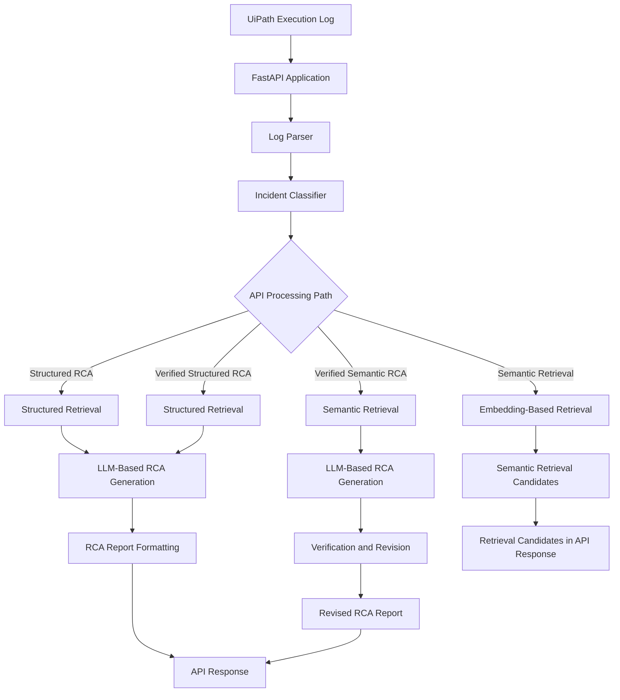

# System Architecture

## Project Objective

**Intelligent Automation RCA** is an AI-assisted incident diagnosis prototype designed to analyze UiPath execution logs, classify incidents, retrieve relevant diagnostic knowledge, and generate Root Cause Analysis (RCA) reports with supporting evidence and recovery recommendations.

The current implementation focuses on evaluating structured retrieval, semantic retrieval, LLM-based RCA generation, and verification-assisted revision. The broader architecture may eventually support additional automation platforms, but the current implementation is UiPath-specific.

---

## 1. Implemented Architecture

The current system receives UiPath execution logs through a FastAPI application. The parser extracts structured incident information, and the classifier maps the incident to the predefined incident taxonomy when possible.

The API exposes different processing paths for structured retrieval, semantic retrieval, and verification-assisted revision.

### High-Level Workflow



**Important:** The semantic retrieval endpoint returns retrieval candidates rather than a complete RCA report. The semantic verification path uses retrieved knowledge for RCA generation and verification-assisted revision. These paths are experimental configurations exposed through separate API endpoints.

### API Processing Paths

| Configuration | Processing | Purpose |
|---|---|---|
| Structured RCA | Structured retrieval → LLM-based RCA generation → report formatting | Generate an RCA using structured knowledge-base retrieval. |
| Semantic Retrieval | Embedding-based retrieval | Return semantically similar root-cause and recovery knowledge candidates. |
| Verified Structured RCA | Structured retrieval → RCA generation → verification-assisted revision | Evaluate whether verification and revision improve the generated report. |
| Verified Semantic RCA | Semantic retrieval → RCA generation → verification-assisted revision | Evaluate semantic retrieval combined with verification-assisted revision. |

The main API endpoints are:

| Endpoint | Responsibility |
|---|---|
| `/` | Health check. |
| `/analyze` | Structured retrieval and RCA generation. |
| `/analyze/semantic` | Semantic retrieval and return of retrieval candidates. |
| `/analyze/verified` | Structured retrieval with verification-assisted revision. |
| `/analyze/combined` | Semantic retrieval with verification-assisted revision. |

---

## 2. Component Responsibilities

### 2.1 FastAPI Application

The FastAPI application exposes the system's HTTP endpoints, receives incident-log inputs, invokes the relevant processing pipeline, and returns the resulting analysis or retrieval output.

### 2.2 Automation Log Parser

The parser extracts structured information from UiPath execution logs to provide incident context for downstream processing.

Depending on the available log content, this context may include:

- Exception messages
- Workflow or activity information
- Error-related details
- Available execution context

The parser's output depends on the format and information present in the input log.

### 2.3 Incident Classification Engine

The classifier maps the extracted incident information to the predefined incident taxonomy where a matching classification can be established.

For example:

```text
UI element not found
        ↓
UI-003
        ↓
Category: UI Automation
Subcategory: Selector
```

Classification is dependent on the implemented taxonomy and classification logic. Unrecognized or ambiguous incidents may not receive a reliable classification.

### 2.4 Knowledge Base

The knowledge base contains predefined diagnostic information used by the retrieval and RCA-generation components.

Its contents include:

- Incident taxonomy and catalog
- Root-cause knowledge
- Recovery recommendations

These entries provide candidate explanations and recovery actions. Their presence in the knowledge base does not establish that a proposed root cause actually occurred in a particular incident.

### 2.5 Retrieval Modules

The system supports two retrieval approaches:

**Structured Retrieval**

Uses the incident's structured context and the implemented knowledge-base matching logic to retrieve relevant diagnostic entries.

**Semantic Retrieval**

Uses the `all-MiniLM-L6-v2` embedding model and cosine similarity to identify semantically similar knowledge-base entries. The current experimental configuration retrieves the top three candidates.

Semantic similarity indicates that entries are related in embedding space; it does not guarantee that they are correct or sufficiently relevant to the incident.

### 2.6 LLM Integration and RCA Generation

The LLM integration module generates RCA content using the incident context and retrieved knowledge supplied by the selected processing path.

The RCA-generation modules support the creation and formatting of diagnostic reports. Depending on the endpoint, the output may include:

- Incident summary
- Probable root-cause explanation
- Supporting evidence
- Recovery recommendations
- Other structured RCA fields

Generated explanations remain hypotheses supported to varying degrees by the available evidence. The system does not independently confirm that a proposed root cause occurred.

### 2.7 Verification and Revision Modules

The verification modules evaluate generated RCA content against the available incident context and retrieved information. In the experimental verification-assisted paths, the system can request a revision when the verifier identifies issues.

The current implementation evaluates verification-assisted revision through a limited experimental process. A verifier outcome such as `PASS` represents the verifier's assessment; it is not a guarantee of factual correctness, retrieval relevance, or complete grounding in incident evidence.

---

## 3. Current Scope and Planned Extensions

### 3.1 Current Implementation

The current prototype focuses on:

- UiPath execution-log parsing
- Incident classification using a predefined taxonomy
- Structured knowledge-base retrieval
- Embedding-based semantic retrieval
- LLM-based RCA generation
- Verification-assisted report revision
- Experimental evaluation of retrieval and report quality

The experiments assess these components using a defined set of test incidents. Their results should be interpreted within that evaluation scope.

### 3.2 Planned Extensions

The broader architecture could be extended to other automation platforms through dedicated platform-specific connectors and parsers, subject to implementation and evaluation.

Potential future integrations include:

- Automation Anywhere
- Microsoft Power Automate
- Blue Prism
- Other enterprise automation platforms

These integrations are architectural possibilities, not supported capabilities of the current implementation.

Additional areas for future work include:

- Improved handling of paraphrased and unfamiliar incidents
- Explicit assessment of retrieval relevance
- Better uncertainty handling and calibrated abstention
- Broader evaluation across incident types and log formats
- Evaluation of diagnostic accuracy and report grounding on larger test sets

### 3.3 Limitations

The current experiments focus on retrieval, RCA generation, and verification-assisted revision. They do not demonstrate autonomous production-code repair, automatic deployment of fixes, or production-level diagnostic reliability.

The quality of the generated RCA depends on the input log, classification outcome, retrieved knowledge, and LLM output. A plausible explanation or recovery recommendation should therefore be reviewed against the actual incident evidence before being used operationally.

---

## 4. Architectural Direction

The long-term objective is to develop a modular architecture in which platform-specific log ingestion and parsing feed into shared incident classification, knowledge retrieval, RCA generation, and verification components.

This direction could enable support for multiple automation platforms while keeping platform-specific integrations separate from the core diagnostic pipeline. However, the architecture's future extensibility should not be confused with functionality that has already been implemented or evaluated.